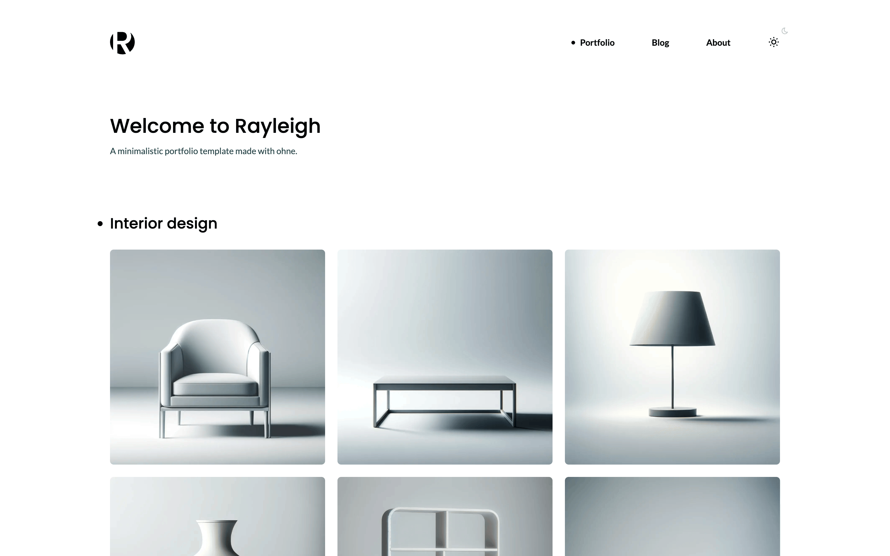

# Rayleigh

A minimalistic portfolio with a gallery, an About page and a blog, edited in a CMS. The CMS is an
[ohne](https://ohne.dev) app, the website is [Nuxt](https://nuxt.com). Free under the MIT licence.

<picture>
  <source media="(prefers-color-scheme: dark)" srcset="screenshots/readme/home-dark.png">
  
</picture>

## Live demo

Try it on [ohne.dev](https://ohne.dev/examples/rayleigh). Sign in to the dashboard as the admin
with one click, edit a page, and watch the website beside the form change as you type.

## Tutorial

Build this site yourself, lesson by lesson, at
[ohne.dev/tutorials/rayleigh/nuxt](https://ohne.dev/tutorials/rayleigh/nuxt).

The same site in Next lives at [ohnejs/rayleigh-next](https://github.com/ohnejs/rayleigh-next).
Its `apps/backend` is identical to this one.

## What it shows

- **Pages built from blocks.** `apps/backend/blocks/` holds `PageIntro`, `Portfolio`, `Image`,
  `Prose` and `Posts`, and `apps/web/app/components/blocks/` one component for each. See
  [blocks](https://ohne.dev/docs/database/blocks).
- **A blog with its own route.** `cms.routes` in `apps/backend/ohne.config.ts` shows a post at
  `/blog/<slug>` and every other path as a page. One catch-all page,
  `apps/web/app/pages/[...slug].vue`, renders both. See
  [routes](https://ohne.dev/docs/cms/setup#routes).
- **A public relation.** Each post names its author from `Authors`, a collection anyone may read,
  so the website receives the whole author. See
  [one reference](https://ohne.dev/docs/database/collections#one-reference).
- **Site settings.** `Settings` is a singleton with the logo, the menu and the footer links, which
  the header and the footer read with `useOhneRead`. See
  [site data](https://ohne.dev/docs/cms/website#site-data) and
  [singletons](https://ohne.dev/docs/database/collections#singletons).
- **A paginated list.** The `Posts` block lists three posts to a page with `useOhneList`, and
  answers `404` past the last page. See [Nuxt](https://ohne.dev/docs/cms/frameworks#nuxt).
- **Rich text.** The `Prose` block's editor offers only what the design has styles for. See
  [rich text](https://ohne.dev/docs/database/rich-text).
- **Uploads in a seed.** `apps/backend/boot/seed.ts` uploads every image with `putUpload`, as an
  editor would. See [uploads in server code](https://ohne.dev/docs/uploads/uploads#in-server-code)
  and [boot files](https://ohne.dev/docs/project/boot).
- **The live editor.** The dashboard shows the website beside the form, and updates it as you
  type. See [the live editor](https://ohne.dev/docs/cms/setup#the-live-editor).
- **No UI library.** Dark mode follows the system until you pick a theme, with no flash on load
  (`apps/web/app/utils/theme.ts`). The full-screen gallery is a native `<dialog>`
  (`apps/web/app/components/Slider.vue`), and the mobile menu a little state in
  `apps/web/app/composables/mobile-menu.ts`.
- **Plain CSS.** `apps/web/app/assets/styles/` holds Rayleigh's colors, fonts and sizes as custom
  properties, then one stylesheet per part of the page. The fonts are self-hosted in
  `apps/web/public/fonts/`.
- **One monorepo.** `apps/backend` and `apps/web` share one pnpm workspace. See
  [monorepo](https://ohne.dev/docs/project/monorepo).
- **Tests.** `apps/backend/tests/` boots the API in the test process and checks what the seed
  serves.

## Getting started

In a copy of this repository:

```sh
pnpm install
pnpm dev
```

| App       | Address                 |
| --------- | ----------------------- |
| Website   | `http://localhost:3000` |
| Dashboard | `http://localhost:9000` |
| API       | `http://localhost:9001` |

The first `pnpm dev` fills the CMS with the demo and prints the admin's password. Sign in to the
dashboard as `admin@example.com` with it.

The seed fills an empty site only, and never under `NODE_ENV=production`. Delete
`apps/backend/.data/` and `apps/backend/.uploads/` to start over.

The checks:

```sh
pnpm typecheck
pnpm test
pnpm lint
pnpm format --check
```

## Upgrading

Bump the versions in the `catalog` of `pnpm-workspace.yaml` and follow the framework's
[release notes](https://github.com/ohnejs/ohnejs/releases). To pick up later changes to this
example, compare your copy with this repository.

## Deploy

Each app deploys on its own. See [deploying](https://ohne.dev/docs/project/monorepo#deploying).

- The backend deploys like [any ohne app](https://ohne.dev/docs/production/deployment). Set
  `SITE_URL` to the website's public address.
- The website builds with `pnpm build` and runs as `node apps/web/.output/server/index.mjs`, with
  `NUXT_OHNE_API` set to your API.

The seed stays out of production, so a new install starts empty. The first visit to the dashboard
opens the install page, where you create the admin.

## Licence and credits

- MIT, see `LICENSE`.
- The images come from the Rayleigh template by Muris Ceman, recompressed. See
  `apps/backend/seed/CREDITS.md`.
- Lato and Poppins are under the SIL Open Font License. See `apps/web/public/fonts/`.
